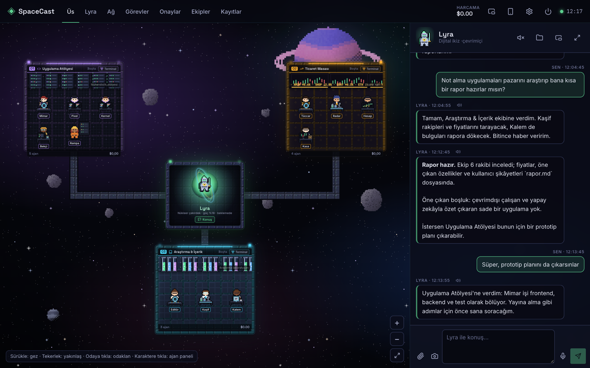
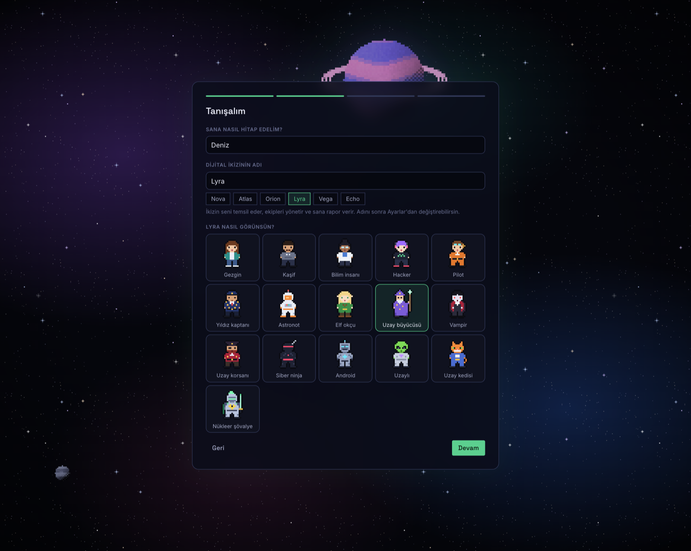
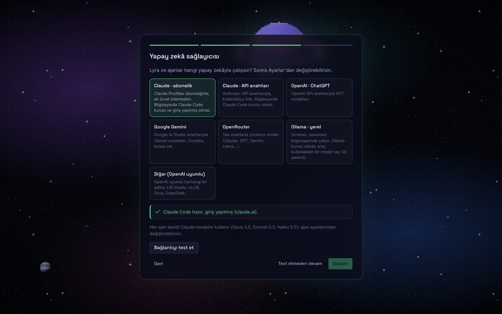
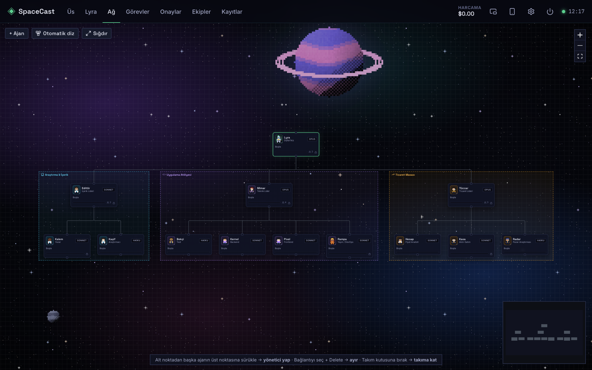
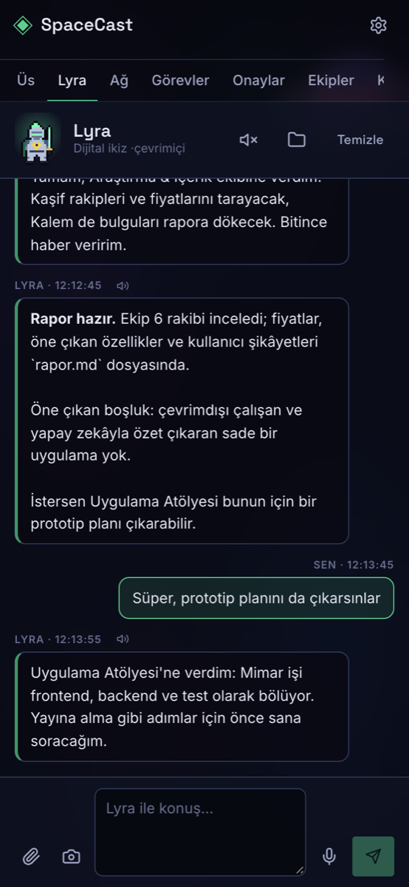
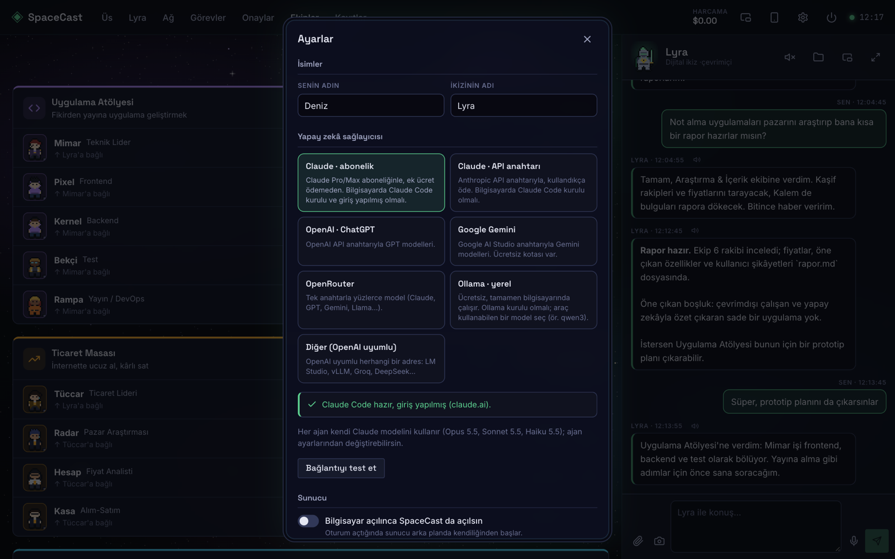

<div align="center">

# ◈ SpaceCast

**Yapay zekâ ajanlarından oluşan kendi ekibini, oyun gibi bir uzay istasyonunda yönet.**

En tepede senin **dijital ikizin** var: ona ne istediğini yaz ya da söyle, işi ekiplere dağıtsın.
Ajanlar araştırır, kod ve rapor yazar; para harcamak gibi riskli adımlar senin onayına gelir.
Her şey kendi bilgisayarında çalışır, telefondan da yönetebilirsin.



</div>

## Özellikler

- **Dijital ikiz.** Adını ve görünüşünü sen seçersin: gündelik kadın ve erkek, bilim insanı, hacker, pilot, elf, büyücü, vampir, korsan, android, uzaylı, uzay kedisi ve daha fazlası (16 piksel karakter). Sohbet eder, işi anlar, doğru ekiplere görev açar ve bitince rapor verir.
- **Sekmeli sohbetler.** İkizinle aynı anda birden fazla konuşma açabilirsin; her görevin raporu ve onay soruları, görevin başladığı sohbete düşer.
- **Düşünme seviyesi.** Her ajan için *Önerilen / Düşük / Orta / Yüksek*. Önerilen seviye ajanın rolüne göre seçilir: sohbet ve planlama düşük, araştırma, yazı ve kod orta.
- **Ajan ekipleri.** Hazır üç ekiple gelir (Uygulama Atölyesi, Ticaret Masası, Araştırma & İçerik); istediğin kadar ekip ve ajan ekleyebilirsin. Liderler işi ekibine aşamalar halinde böler, ekip aynı çalışma klasöründe birlikte çalışır.
- **Gerçek iş.** Ajanlar web'de araştırır, dosya okur ve yazar, kod geliştirir. Çıktılar `data/workspaces` altındaki görev klasörlerinde durur.
- **Onay kuyruğu.** Para harcamak, yayına almak, mesaj göndermek gibi geri alınamaz işler ajanlar tarafından yalnızca önerilir; sen onaylamadan yapılmaz.
- **İstediğin yapay zekâ.** Claude (abonelik ya da API anahtarı), OpenAI, Google Gemini, OpenRouter, Ollama ile tamamen yerel ya da OpenAI uyumlu herhangi bir servis.
- **Oyun gibi arayüz.** Piksel sanat uzay istasyonu: her ekip temalı bir odada, her ajan rolüne göre giyinmiş bir karakter. Gezinmek ve yakınlaşmak serbest. Odaları ikize bağlayan kablolarda fosforlu akış görürsün: yeşil şerit ikizden odaya giden emirler, kırmızı şerit odadan dönen raporlar. Ekip çalışırken akış hızlanır, duraklatılınca söner.
- **Arka plan temaları.** Mor nebula, derin okyanus, kızıl bulutsu, zümrüt aurora, altın güneş, pembe galaksi ve sessiz boşluk. Ayarlar'dan seçilir, her cihaz kendi seçimini hatırlar.
- **Vurgu rengi.** Radyoaktif yeşil, plazma mavisi, kobalt, mor enerji, neon pembe, kızıl çekirdek, turuncu alev ya da altın. Düğmeler, sekmeler, seçimler ve ikizin nükleer reaktöründeki ışıklar seçtiğin renge bürünür.
- **Telefondan kontrol.** QR kodu okut, ana ekrana ekle; aynı Wi-Fi'da ya da Tailscale ile her yerden.
- **Sesli konuşma, fotoğraf ve dosya.** Mikrofonla konuş, fotoğraf gönder, bilgisayarındaki klasörleri ajanlara (salt okunur ya da yazılabilir) aç.
- **Uçan pencere.** İkizinle her zaman üstte duran küçük bir pencerede konuş (Chrome).

## Kurulum

### 1. Gerekenler

- **[Node.js](https://nodejs.org) 22.18 ya da üstü** (24 LTS önerilir).
- **Bir yapay zekâ sağlayıcısı** (ilk açılışta seçiyorsun, aşağıdaki tabloya bak).

### 2. İndir ve başlat

```bash
git clone https://github.com/ardabelli/SpaceCast.git
cd SpaceCast
npm install
npm start
```

Tarayıcıda **http://localhost:5199** kendiliğinden açılır.

Terminal kullanmak istemiyorsan: projeyi indirdikten sonra macOS'ta **`SpaceCast.command`**, Windows'ta **`SpaceCast.bat`** dosyasına çift tıkla. Gerekirse kurar, başlatır ve tarayıcıyı açar.

### 3. İlk açılış

Kısa bir kurulum seni karşılar: adını, ikizinin adını ve kullanacağın yapay zekâyı seçersin, bağlantıyı tek tuşla test edersin.

<table>
  <tr>
    <td></td>
    <td></td>
  </tr>
</table>

## Yapay zekâ sağlayıcıları

| Sağlayıcı | Ne gerekir | Not |
| --- | --- | --- |
| **Claude · abonelik** | Claude Pro/Max + [Claude Code](https://claude.com/claude-code) | Ek ücret yok. Kurulum ekranındaki "Claude ile giriş yap" tuşu girişi açar. En yetenekli seçenek: ajanlar komut da çalıştırabilir. |
| **Claude · API anahtarı** | [Anthropic API anahtarı](https://console.anthropic.com/settings/keys) + Claude Code | Kullandıkça ödersin. |
| **OpenAI** | [OpenAI API anahtarı](https://platform.openai.com/api-keys) | |
| **Google Gemini** | [Google AI Studio anahtarı](https://aistudio.google.com/apikey) | Ücretsiz kotası var. |
| **OpenRouter** | [OpenRouter anahtarı](https://openrouter.ai/keys) | Tek anahtarla birçok model. |
| **Ollama** | [Ollama](https://ollama.com) ve bir model (`ollama pull qwen3:8b`) | Ücretsiz, tamamen bilgisayarında. Araç kullanabilen bir model seç. |
| **Diğer** | OpenAI uyumlu bir adres | LM Studio, vLLM, Groq, DeepSeek… |

Claude Code'u kurmak için (macOS / Linux):

```bash
curl -fsSL https://claude.ai/install.sh | bash
```

Windows'ta PowerShell'de: `irm https://claude.ai/install.ps1 | iex`

Claude dışındaki sağlayıcılarda ajanlar dosya okuyup yazabilir ve web'de arama yapabilir; komut çalıştırma yalnızca Claude ile kullanılabilir. Sağlayıcıyı istediğin zaman **Ayarlar**'dan (sağ üstteki dişli) değiştirebilirsin. API anahtarları yalnızca senin bilgisayarında, `data/config.json` dosyasında saklanır.

## Kullanım

| Sekme | Ne yapar |
| --- | --- |
| **Üs** | İstasyonun üstten görünümü. Ortada ikizinin reaktörü, etrafında ekip odaları. Sürükleyerek gez, tekerlekle yakınlaş, odaya tıklayıp terminalini aç. |
| **İkizin** | Sohbet: iş ver, durum sor, "dur" ya da "devam" de, onayları buradan ver. Üstteki sekmelerden yeni sohbet aç (çift tıkla: yeniden adlandır). Sağ üstten ikizin düşünme seviyesini seç. Mikrofon, fotoğraf ve dosya ekleme burada. |
| **Ağ** | Kim kime bağlı: bir ajanın alt noktasından diğerinin üst noktasına sürükle, onu yöneticisi yap. |
| **Görevler** | Açılan görevler, alt işler ve çıktıların bulunduğu klasör. |
| **Onaylar** | Ajanların senden onay beklediği işler. |
| **Ekipler** | Ekip ve ajan ekle, düzenle; her ajanın modeli, düşünme seviyesi, araçları, yetkisi ve harcama limiti. |
| **Kayıtlar** | Her şeyin canlı akışı. |

<table>
  <tr>
    <td width="62%"></td>
    <td></td>
  </tr>
</table>

### Telefondan

Sağ üstteki telefon simgesine bas, QR kodu telefonla okut. Telefon bilgisayarla aynı Wi-Fi'da olmalı. Evden uzaktayken bağlanmak için iki cihaza da [Tailscale](https://tailscale.com) kur; SpaceCast Tailscale adresini kendisi bulur. iPhone'da Paylaş → **Ana Ekrana Ekle** dersen ayrı bir uygulama gibi açılır.

Bağlantıdaki erişim kodu, başkalarının senin üssünü yönetmesini engeller. Kodu olmayan bir cihaz giriş ekranında kalır.

### Sunucuyu açma, kapama

SpaceCast bilgisayarında küçük bir sunucu olarak çalışır; kapalıyken ajanlar çalışmaz ve telefondan bağlanılamaz. **Ayarlar → Sunucu** bölümünde:

- **Bilgisayar açılınca SpaceCast da açılsın.** Oturum açtığında arka planda kendiliğinden başlar.
- **Açıkken bilgisayar uyumasın.** Telefondan her an bağlanabilmek için. macOS'ta yalnızca şarjdayken geçerlidir. SpaceCast kapanınca kalkar.
- **Açma/kapama kısayolu (macOS).** Uygulamalar klasörüne bir SpaceCast simgesi ekler. Dock'a sürükle: tıklayınca sunucuyu açar, açıksa kapatmayı sorar.
- **Sunucuyu kapat.** Üst çubuktaki güç tuşu da aynı işi yapar.



## Pil ve ısı

SpaceCast varsayılan olarak **pil dostu** çalışır. Karakterler yürür, durup etrafa bakar, nefes alır; reaktör atar, halkaları döner; kablolar akar, yıldızlar parlar. Ama bunların hepsi piksel oyunlardaki gibi saniyede ~6-7 karelik tek bir döngüyle yapılır (`src/life.ts`): ekran kartı saniyede 60 kez değil, yalnızca bu karelerde birkaç küçük öğeyi günceller, aradaki zamanda boşta kalır. Bulanıklık, hareketli filtre gibi pahalı efektler kullanılmaz; pencere gizliyken ya da bir panel açıkken döngü durur. Akıcı 60 karelik animasyonlar istersen **Ayarlar → Arka plan → Canlı animasyonlar** ile açılır (daha çok pil yer).

## Güvenlik ve gizlilik

- Sohbetler, görevler, ayarlar ve API anahtarları yalnızca `data/` klasöründe durur ve git'e eklenmez.
- Ajanlar yalnızca kendi görev klasörlerine ve senin açtığın klasörlere erişir. "Sadece okuma" verdiğin klasörlerde hiçbir dosyayı değiştiremezler. Sistem klasörleri, ev klasörünün tamamı ve `.ssh` gibi gizli klasörler açılamaz.
- Claude ile ajanlar kısıtlı modda çalışır: senin Claude ayarlarını ve MCP sunucularını görmezler, izin verilmeyen her şey sormadan reddedilir. Komut çalıştırma yalnızca "Tam yetkili" ajanlarda, belirli komutlarla (npm, node, git…) açıktır.
- Para harcama, satın alma, yayına alma ve dışarıya mesaj gönderme ajanlar tarafından yapılmaz; yalnızca onay kuyruğuna öneri olarak düşer.
- Sunucu yerel ağa açıktır ama bu bilgisayar dışındaki her istek erişim kodu ister. Kodu değiştirmek için sunucuyu durdurup `data/config.json` içindeki `key` alanını sil.

## Geliştirme

```bash
npm run server   # sunucu, değişince yeniden başlar (port 5199)
npm run dev      # arayüz, anında yenilenir (port 5173)
npm run typecheck
```

| Klasör | İçerik |
| --- | --- |
| `server/` | Node sunucusu: WebSocket ile durum eşitleme, ajan yürütücüsü (`runner.ts`), sağlayıcılar (`claude.ts`, `openai.ts`, `ai.ts`), kurulum (`settings.ts`) ve sistem ayarları (`system.ts`) |
| `shared/` | Sunucu ve arayüzün ortak tipleri, durum mantığı, başlangıç ekipleri, sağlayıcı listesi |
| `src/` | React arayüzü: istasyon görünümü, piksel sanat üretimi, sohbet, kurulum ve ayarlar |

TypeScript dosyaları derlenmeden doğrudan Node ile çalışır (Node'un yerleşik tip ayıklaması). Başlangıç ekiplerine dönmek için sunucuyu durdurup `data/state.json` dosyasını sil.

## Bilinen sınırlamalar

- Windows ve Linux'ta daha az denendi. Sorun görürsen issue aç.
- Harcama yalnızca Claude'da hesaplanır; diğer sağlayıcılarda token sayılır ama ücret gösterilmez.
- Telefonda mikrofon için tarayıcı güvenli bağlantı (HTTPS) ister. Düz `http://` adresinde yazarak konuşabilirsin.
- Onaylanan işlemler (ödeme, yayın) henüz gerçek servislere bağlı değil; onay kayda geçer.

## Lisans

[MIT](LICENSE)

---

**English:** SpaceCast is a local-first, game-like dashboard for running your own team of AI agents, led by a digital twin you name yourself. Pick any provider on first launch (Claude subscription or API key, OpenAI, Gemini, OpenRouter, Ollama, any OpenAI-compatible endpoint), talk to your twin, and approve risky actions. Requires Node.js 22.18+: `npm install && npm start`, then open http://localhost:5199. The UI is in Turkish.
